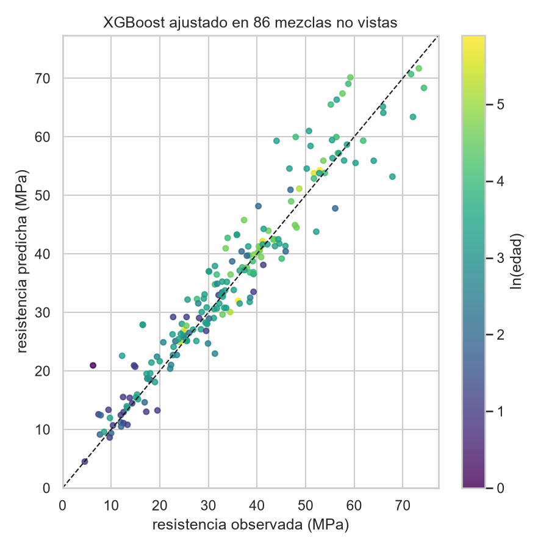

# Predictor de resistencia a compresión del concreto

Modelo de machine learning que estima la resistencia a compresión del concreto (MPa) a partir de la dosificación y la edad, con validación por grupos de mezcla, interpretabilidad con SHAP y una app interactiva.

**Autor:** Luis Daniel Alvarez Medina · [LinkedIn](https://www.linkedin.com/in/luis-daniel-alvarez-medina-10a0ab2a2) 



## Resultados

| Modelo | RMSE validación cruzada por grupos (MPa) | RMSE en prueba reservada (MPa) |
|---|---|---|
| Abrams + ln(edad) (línea base) | 8.7 | 7.53 |
| Random Forest | 5.9 | 4.72 |
| LightGBM ajustado | 5.5 | 4.80 |
| **XGBoost ajustado (modelo final)** | **5.6** | **4.56** (IC95: 3.76–5.26) |

- **Error esperado: 5.5–5.7 MPa (RMSE).** La prueba reservada (86 mezclas no vistas, R² = 0.913) salió más favorable que la validación cruzada; es una sola separación y no debe tomarse como el desempeño típico.
- El modelo reduce el error de la línea base de Abrams en torno a un 36–39 %.
- Las diferencias entre XGBoost, LightGBM y Random Forest están dentro de la variabilidad entre particiones: no se declara un ganador.

## Metodología

1. **Datos:** *Concrete Compressive Strength* (Yeh, UCI), 1030 ensayos de 17 fuentes. Se eliminaron 25 duplicados exactos (1005 filas, 427 mezclas distintas).
2. **Exploración:** los datos reproducen la ley de Abrams; agua/ligantes (ρ = −0.59) correlaciona mucho más con la resistencia que el agua sola (−0.28).
3. **Variables derivadas** (`src/features.py`): ligantes, agua/ligantes, agua/cemento, fracción de adiciones, fracción de arena y ln(edad).
4. **Validación por grupos de mezcla.** Una misma dosificación aparece a varias edades (75 % de las filas pertenecen a mezclas con 2 o más edades). Con validación aleatoria el Random Forest alcanza R² = 0.920 (RMSE 4.60); con validación por grupos baja a R² = 0.882 (RMSE 5.59): la diferencia es fuga de información.
5. **Prueba reservada:** 20 % de las mezclas, separado antes de ajustar nada. El modelo final se fijó antes de evaluarlo y la prueba se usó una sola vez.
6. **Ajuste con Optuna** (60 pruebas por modelo, solo sobre entrenamiento). La mejora fue pequeña (≈0.15–0.2 MPa).
7. **Interpretación con SHAP** y barridos sobre una mezcla de referencia: edad y agua/ligantes dominan; el modelo respeta la monotonía esperada (más agua, menos resistencia; más cemento o edad, más resistencia).

## Hallazgos

- A igual agua/ligantes hay mucha dispersión: otras variables y diferencias entre estudios.
- La penalización de las mezclas con muchas adiciones (escoria, ceniza) es mayor a edades tempranas y se reduce con la edad, pero no se convierte en ventaja a edades largas en estos datos.
- Mezclas con la misma dosificación y edad difieren en varios MPa: probable influencia de variables no registradas (tipo de cemento, curado, probeta).

## Limitaciones

- Concretos convencionales y de alta resistencia (2–83 MPa); **no es UHPC**.
- Sin datos fiables a 1–2 días (2 ensayos); el modelo da el mismo valor para 1 y 3 días.
- Por encima de ~60 MPa subestima (≈ −5 MPa en la prueba) y hay pocos datos sobre 74 MPa.
- Los modelos de árboles no extrapolan: con agua/ligantes = 0.90 predijo 22.6 MPa frente a 12.3 observados. Con cemento alto sin adiciones ni aditivo, la respuesta crece más de lo que sugiere Abrams.
- El agrupamiento por mezcla es por coincidencia exacta; mezclas casi idénticas quedan en grupos distintos, por lo que la fuga residual subestima el error.
- El modelo describe asociaciones del conjunto de datos, no efectos causales.

## Estructura

```
data/raw, data/processed   datos originales y procesados
notebooks/                 01 auditoría · 02 exploración · 03 variables · 04 validación · 05 modelos · 06 SHAP
src/features.py            variables derivadas
models/                    modelo final (xgb_final.json) e hiperparámetros
app/app.py                 app de Streamlit
reports/figures            figuras
```

## Reproducir

```bash
python -m venv .venv
.venv\Scripts\activate        # Windows
pip install -r requirements.txt
streamlit run app/app.py
```

`requirements-lock.txt` contiene las versiones exactas de todas las dependencias.

## Datos y referencias

Yeh, I-C. (1998). Modeling of strength of high-performance concrete using artificial neural networks. *Cement and Concrete Research*, 28(12). Dataset de UCI Machine Learning Repository, licencia CC BY 4.0.

## Próximos pasos

- Agrupar mezclas con tolerancia para reducir la fuga residual.
- Restricciones de monotonía en XGBoost.
- Extender el flujo a datos de UHPC/UHPFRC, con validación por estudio.